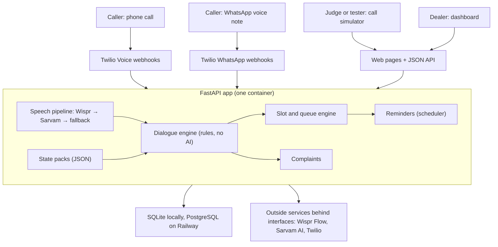

# Ration Bolo — Voice-First Ration Shop Assistant

Nov 27, 2026 · @Sandeep · **Version 3**

> **What changed in version 3.** F01–F28 are merged. Version 3 removes the assumption that the state department and the dealer will cooperate. A new section, "Works without a partner", defines three shop levels and backlog items **F29–F39**: cardholder reports, public PDS data, best-time advice, nearby-shop portability, official complaint routing and escalation, a public transparency page, dealer incentives, volunteer queue coordinators, and the deck and demo updates. Everything already built keeps working unchanged at Shop 108.
>
> **What changed in version 2.** F01–F22 were built and merged under version 1. Version 2 adds the official Round 2 FAQ rules (no login wall on the live link, deck section names, PDF limits, YouTube-only video, submission checks) and backlog items **F23–F28**, which fix problems found in a review of the merged build: shared demo state breaks the scripted flow for the next judge on the live link, the dealer and admin pages sit behind a PIN, the deck uses old section names and stale numbers, and the real speech adapters have never been tested against the live APIs.

## Summary

Ration Bolo lets ration cardholders anywhere in India check stock, hear the live queue, book a time slot and report short rations at their ration shop **by speaking**, on a phone call or a WhatsApp voice note. No app, no reading and no typing are needed. About 80 crore people collect grain every month from about 5.5 lakh ration shops under the National Food Security Act; in the pilot city, Hyderabad, roughly 650 shops serve 6.5 to 8.4 lakh ration cards. Today families arrive early, wait for hours, and are often told "come tomorrow." Ration Bolo turns that into one phone call and a time slot.

This is the build for **Round 2 of the Scaler × Wispr Flow "Build for Bharat" hackathon** (theme: Public infrastructure and civic services). It extends the Round 1 idea, prompt and impact answers that already passed review, so the build must match them.

**Design principles** (every later section follows from these):

1. **Voice is the product.** Every task can be finished by speaking. Keypad, buttons and text exist only as fallbacks.
2. **Works on any phone.** A phone call works on a basic feature phone; WhatsApp serves smartphone users; the web is for dealers, testers and judges.
3. **Speech engines hear, rules decide.** Speech-to-text only turns audio into text. Every decision (intent, booking, wait time, complaint) is deterministic, tested code. No LLM makes decisions.
4. **Never strand the caller.** Every failure has a next step: ask again, switch speech engine, offer a keypad or numbered menu, or end politely with a text summary. There is no dead end.
5. **Confirm before saving.** Card digits, kilos and times are always read back, and nothing is saved without a yes.
6. **Walk-ins are never turned away.** Half of every window is kept for walk-ins. A booking saves waiting time; it never gives more rice or a better claim on stock.
7. **Private by default.** Names are never spoken. Cards are confirmed by their last digits, phone numbers are masked on screens, and caller audio is not stored after transcription.
8. **Every state is configuration.** Languages, phrases, keywords and entitlements live in a per-state "state pack" file. Adding a state means adding a file, not changing code.
9. **Starts anywhere, with no keys.** `docker compose up` on a fresh clone shows a working app with no secret keys. Features that need a key say "key not set" and fall back.

## Hackathon submission requirements (hard constraints)

Submission closes **30 Nov 2026, 11:59 PM IST**, and can be made **only once**. Judges start the app from the GitHub code; if it does not start, the build cannot move ahead.

1. **Code on GitHub:** public repository, kept public until Round 3 ends (or at least until Round 2 results); `docker-compose.yml` starts the app with one command; the main screen works **without a `.env` file or any real keys** (features needing a key show a "key not set" message); `.env.example` lists every environment variable with placeholder values; about **300+ lines of code written during the hackathon** (a barely changed starter template fails). Any tech stack is allowed as long as it runs with Docker Compose.
2. **Demo video on YouTube only** (Vimeo and Google Drive links are rejected): public or unlisted, **3 minutes or less**, showing the product working, including a live voice interaction.
3. **Pitch deck (PDF, at most 30 pages and 10 MB):** judges read the text, not images, so key points are written as text. It must cover: (1) problem and solution, (2) addressable market (who it is for and how many), (3) third-party dependencies (voice providers, models, APIs) with their cost and availability risks and what happens if they get costly or stop working, (4) go-to-market plan. It must also state the tech stack and why each choice was made.
4. **Live link (optional bonus):** a public URL with **no login wall**, showing the same prototype as the repo, self-hosted and reachable during evaluation (until at least **2 Dec 2026**). Not having one never counts against us.
5. **The prototype must be voice-first:** end users give input by voice. It must work end to end for one core flow; it need not be a full product.
6. **Submission checks:** after Submit, the repo, video and deck are checked automatically within about a minute. A failed check (private repo, private or too-long video) returns the submission to draft by email so it can be fixed before the deadline. Once verified it can't be changed, and an unsubmitted draft is submitted automatically at the deadline. So submit early, by the afternoon of 30 Nov.
7. **Round 3 continues the same idea,** so the design must have room to grow (see Phase 5).

## Instructions for the Claude Code session

This file is the single source of truth. Starting from an empty repository, build the whole application unattended, following every rule in this section and in the Git workflow (Build phases section).

**1. Bootstrap (first session only).** The repo is empty, so the very first commit goes straight to `main`. It contains only:

- `SPEC.md`: this file, unchanged.
- `CLAUDE.md`: the working rules copied from this section and the Git workflow, so every later session follows them: one functionality per branch, PR, local merge, at most one open branch; author and committer `Sandeep Sakilam <sakilamsandeep@gmail.com>`; no mention of Claude or Claude Code in any commit title or message, PR title or PR description; the app must always start with `docker compose up` and no keys.
- `PROGRESS.md`: the Functionality backlog below as a checklist, plus a "Current" line naming the branch in progress.
- `DECISIONS.md`: an empty decision log.
- `.gitignore`, `.env.example`, and a short `README.md`.

After that commit, everything follows the Git workflow.

**1a. Spec updates.** When `SPEC.md` is replaced with a newer version, the first branch of the session is `docs/spec-vN` (N = the version): it replaces `SPEC.md`, adds the new backlog rows to `PROGRESS.md` unticked, and copies any changed working rules into `CLAUDE.md`. It goes through the normal PR and local merge before any functionality work.

**2. Start of every session.** Read `CLAUDE.md`, `SPEC.md` and `PROGRESS.md`, and check for open branches and PRs. If a functionality is in progress or waiting to merge, finish and merge it before anything new. Then take the next unchecked backlog item.

**3. Don't stop to ask.** When something is unclear, pick the option most consistent with the design principles, write one line in `DECISIONS.md` (date, question, choice, reason), and carry on. Stop only before an action that can't be undone outside the repo, such as spending real money, buying a phone number, or calling or messaging real people.

**4. External services never block the build.** Every outside service (Wispr Flow, Sarvam AI, Twilio Voice, Twilio WhatsApp, Twilio SMS, state government data) gets an interface, a **mock adapter** and a **real adapter**, chosen by an environment variable. The real adapter turns on only when its keys are present. Tests always use mocks and never call real APIs. Demo data is labelled on screen as "Demo data".

**5. Secrets.** Never commit secrets. Every key is listed in `.env.example` with a comment saying where to get it. All keys are optional for the app to start.

**6. Keyless start is sacred.** After every merge, `docker compose up` on a clean checkout with no `.env` must start the app and show the call simulator. A change that breaks this is not done.

**7. Definition of done** for each functionality:

- code and tests written;
- the local quality gate passes (`make check`: ruff lint, ruff format check, mypy, pytest; plus `make e2e` with Playwright for any user flow it touches);
- docs updated where relevant;
- `PROGRESS.md` ticked in the same PR;
- PR opened, merged locally into `main`, pushed, local branch deleted.

**Cloud session environment notes:**

- **Opening PRs:** `gh pr` commands are blocked in cloud sessions. Open PRs with the built-in GitHub tools or with `gh api repos/{owner}/{repo}/pulls` (REST).
- **Services:** PostgreSQL 16 and Docker are pre-installed but not running. Start them when needed (`service postgresql start`, `docker compose up`).
- **Browser tests:** Chromium is pre-installed under `/opt/pw-browsers`. Never run `playwright install`; if the Python Playwright package can't find a browser, launch Chromium with `executable_path` pointing there.
- **Command time limits:** keep long commands (full test runs, image builds) under 10 minutes, or run them in the background.

**8. Demo data.** Seed the Hyderabad pilot exactly as in the Demo data section. Seeding runs only when tables are empty, so redeploys never wipe real bookings. The dealer dashboard's "Reset demo" button restores it on demand.

**9. Tasks only Sandeep can do.** Keep these listed in `README.md` under "What Sandeep must provide". Build everything else with mocks meanwhile.

- API keys: Wispr Flow API, Sarvam AI.
- Twilio: account top-up (leave trial mode), buy a US local voice number, enable India in voice geographic permissions, join the WhatsApp sandbox, set the webhook URLs.
- Railway: account, project from the GitHub repo, PostgreSQL service, environment variables, public domain.
- GitHub settings: keep the repo public, allow direct pushes to `main`, turn off the email-privacy push block, verify the email on the account.
- Checking the Telugu and Hindi phrases in the state pack with native speakers.
- Running `scripts/smoke_real.py` (F26) with real keys and fixing any key or endpoint problem it reports.
- Deleting the merged remote feature branches on GitHub.
- Version 3: confirm the state's food grievance helpline number and the district grievance officer contact for the Telangana pack; find the public PDS portal page with shop-wise sales for Hyderabad and confirm its URL and format; decide whether to buy a second Twilio number for missed-call check-ins (optional); have native speakers check the new report, opt-in and nearby-shop phrases.
- Recording and uploading the demo video, building the final deck PDF with the video and live links, and the hackathon submission itself.

### Functionality backlog

Build in this order, one row per branch. IDs go in branch names and PR titles. **F01 to F28 are merged** (versions 1 and 2). **F29 to F39 are version 3** and must be merged by **30 Nov 2026, 12:00 noon IST**, so the video, deck and live link can be finished and submitted that afternoon. They are ordered so that `main` is shippable after every merge: if time runs out, stop after any item and submit.

| ID | Functionality | Branch |
| --- | --- | --- |
| F01 | Repo layout, FastAPI app skeleton, Dockerfile (with ffmpeg), `docker-compose.yml` (app only; optional `postgres` profile), Makefile quality gate, GitHub Actions CI, health endpoint | feat/f01-foundation |
| F02 | Database models (SQLAlchemy 2), SQLite default and PostgreSQL via `DATABASE_URL`, demo seed, reset | feat/f02-data-model |
| F03 | State pack format, schema validation, loader, Telangana pack | feat/f03-state-packs |
| F04 | Slot and queue engine: windows, booked and walk-in places, late rule, wait estimate, quietest window, pause on stock-out or machine down | feat/f04-slot-engine |
| F05 | Speech understanding: keyword and fuzzy intent matching, numbers, digits, kilos, day and session words, yes/no, language switch | feat/f05-understanding |
| F06 | Dialogue engine: channel-independent state machine for card check, stock, queue, booking, complaint, fallbacks, silence, unknown number, several cards | feat/f06-dialogue |
| F07 | Adapter interfaces and mocks for speech-to-text, text-to-speech, voice calls, WhatsApp, SMS and state data; service status endpoint ("key not set") | feat/f07-adapters |
| F08 | Speech pipeline: audio conversion with ffmpeg, Wispr Flow and Sarvam real adapters, engine fallback chain, reply audio cache, fixed-prompt audio | feat/f08-speech-pipeline |
| F09 | Call simulator web page with WhatsApp voice-note mode; browser speech fallback; keypad; caller and state selector | feat/f09-simulator |
| F10 | Dealer dashboard: live queue, serve next (simulated ePoS sale), walk-in tokens, stock and machine status by button and voice, complaints, outbox, reset demo | feat/f10-dealer-dashboard |
| F11 | Reminders (20 minutes before a slot) and the message outbox, persisted across restarts | feat/f11-reminders |
| F12 | Twilio Voice channel: inbound call webhooks, record → transcribe → reply, keypad menu, outbound reminder calls, signature check | feat/f12-voice-channel |
| F13 | Twilio WhatsApp channel: voice notes in and out, text summaries, numbered menu fallback, signature check | feat/f13-whatsapp |
| F14 | Impact metrics page: wait times, bookings, voice success rate, engine usage, complaints | feat/f14-metrics |
| F15 | Acceptance suite: Playwright "Done when" flows, PostgreSQL test run, fresh-clone keyless Docker check script | feat/f15-acceptance |
| F16 | Railway deployment files and deploy guide, including Twilio console setup and local tunnelling | feat/f16-deploy |
| F17 | Submission pack: judge quickstart in README, demo video script, pitch deck text and PDF build script (submission cut, 30 Nov 2026) | feat/f17-submission-pack |
| F18 | Second state pack (Tamil Nadu, marked draft) to prove the all-India design | feat/f18-second-pack |
| F19 | Phone-to-card link verification by one-time code (mock SMS) | feat/f19-link-verification |
| F20 | Indian telephony adapter stub (Exotel) behind the voice-call interface | feat/f20-indian-telephony |
| F21 | Accessibility (WCAG 2.2 AA) and low-bandwidth audit of the web pages | feat/f21-accessibility |
| F22 | Multi-shop admin and CSV import of shops and ration cards | feat/f22-multi-shop |
| F23 | Shared live demo safety: demo callers start fresh on every new call, demo status toggles auto-restore, nightly demo reset | feat/f23-shared-demo |
| F24 | No login wall: dealer and admin pages open when no PIN is set (the default); PIN required only when set | feat/f24-no-login-wall |
| F25 | Build identity and submission checklist: commit SHA on `/health`, `/api/status` and the page footer; `docs/SUBMISSION_CHECKLIST.md` | feat/f25-submission-checklist |
| F26 | Real-adapter smoke script for Wispr Flow, Sarvam and Twilio, run by hand with real keys, never in CI | feat/f26-real-smoke |
| F27 | Deck refresh: FAQ section names, finale features, live numbers, PDF limit checks, rebuilt PDF | feat/f27-deck-refresh |
| F28 | Demo video script version 2 with a real live voice interaction, and a recording checklist | feat/f28-demo-script-v2 |
| F29 | Deck slide "Works without a partner: three levels" and the matching Risks text, rebuilt PDF (safe early win) | feat/f29-deck-three-levels |
| F30 | Shop levels 0, 1 and 2: per-shop capabilities, honest wording in every flow, level shown on dashboard and admin, version 3 demo shops | feat/f30-shop-levels |
| F31 | Cardholder reports: spoken stock, machine and queue reports, "I'm at the shop" check-in (keypad 9 and an optional missed-call number), agreement and decay model | feat/f31-crowd-reports |
| F32 | Public PDS data adapter: interface, fixture-backed mock, configurable real adapter for a state portal's shop-wise sales report, polling and signals | feat/f32-public-pds |
| F33 | Best-time advice: hourly crowd profile per shop and weekday, predicted wait by hour, spoken advice, used instead of booking at Level 0 | feat/f33-best-time |
| F34 | Nearby-shop portability (One Nation One Ration Card): shop locations, ranking, spoken suggestion, booking there when allowed | feat/f34-nearby-shops |
| F35 | Official complaint routing and escalation: grievance channel interface, helpline handoff, prepared complaint text, reference capture, 7-day escalation ladder | feat/f35-grievance-routing |
| F36 | Public transparency page per shop and monthly report for vigilance committees and social audits, with minimum-count privacy | feat/f36-transparency |
| F37 | Dealer incentives: dealer phone line (keypad or one sentence), "Rice arrived" broadcast to opted-in cardholders, "Fair shop" badge | feat/f37-dealer-incentives |
| F38 | Volunteer queue coordinator mode: a self-help-group or ward volunteer runs tokens at a Level 0 shop, making it Level 1 (volunteer) | feat/f38-volunteer-mode |
| F39 | Version 3 docs: deck, demo video script, README, metrics for reports and levels, submission checklist, rebuilt PDF | feat/f39-v3-docs |

## Users and roles

| Role | Who | What they do | What they can see |
| --- | --- | --- | --- |
| Cardholder (caller) | Ration cardholder or a family member calling for them | Checks stock and queue, books a slot, reports short rations, by voice | Only their own card's entitlement, bookings and complaints |
| Dealer | Ration shop dealer | Updates stock and machine status by voice or button, serves the queue, issues walk-in tokens, sees complaints | Their shop's queue, with card numbers shown only as last 4 digits and phones masked |
| Tester or judge | Anyone running the app | Uses the call simulator as any demo caller; opens the dealer dashboard with the demo PIN | Demo data only |
| Department (future) | State Civil Supplies Department | Reviews complaints and shop metrics | Aggregated metrics and complaints for their shops |

## End-to-end flows

All phrases below come from the Telangana state pack. Romanised Telugu is shown with English in brackets.

1. **Call starts and the card is confirmed**
   1. The caller's phone number is linked to a card. The app says: "Namaskaram, Ration Bolo. Card chivari ankelu 0421, sare na?" ("Card ending 0421, right?"). It never says a name.
   2. If the shop is out of stock or the machine is down, the app says so straight away, before anything else.
   3. After "Avunu" (yes), it asks: "Meeku ela sahayam cheyali?" ("How can I help?").
   4. **Unknown number:** it asks for the card number digit by digit, reads it back, and after a yes saves the link for next time.
   5. **Several cards on one phone:** it reads each card's last 4 digits and asks which one; if two match, it reads the last 6.
   6. **"No" to the card check:** it asks for the card number as for an unknown number.
2. **Stock:** "Maa shop ki biyyam vachaya?" ("Has rice come?") → "Avunu, biyyam vachindi. Mee kutumbaniki 24 kilolu." ("Yes, rice has come. 24 kg for your family.") Entitlement = members × the pack's kilos per person.
3. **Queue:** "Ippudu entha mandi unnaru?" ("How many are there now?") → "18 mandi mundu unnaru, sumaru 36 nimishalu." ("18 ahead, about 36 minutes.") It may add the quietest open window tomorrow.
4. **Booking**
   1. "Repu poddhuna book cheyyandi." ("Book tomorrow morning.") → the app offers the first window with a free booking place in that session and confirms: "Repu 10:20 ki, sare na?" ("Tomorrow at 10:20, okay?").
   2. "Avunu" → booked; the app says the token number and sends it by SMS (WhatsApp users get it on WhatsApp).
   3. "Kaadu" (no) → it offers the next free window, up to two more, then asks for a different day or session.
   4. Booking is refused, with a spoken reason, when the card already has a booking this month, or when booking is paused.
5. **Reminder:** 20 minutes before the slot, the app calls back: "Bayaluderandi, mundu mugguru unnaru." ("Leave now, three are ahead."). The number ahead is computed live. The dealer dashboard has a "Send reminder now" button for demos.
6. **Complaint:** "Naaku 15 kilolu ichharu" ("I got 15 kg") → the app compares with the 24 kg due, reads back "15 kilolu, sare na?", files a complaint with an ID after a yes, and reads the ID back. If the amount received is at least the amount due, it says so and files nothing.
7. **Dealer updates:** the dealer says "Biyyam aipoyindi" / "Chawal khatam" (rice finished) or "Machine down", or taps the matching button. Status updates instantly on every channel and booking pauses. "Biyyam vachindi" / "Machine working" resumes it.
8. **Hindi flow:** the same flows work in Hindi: "Mera ration aaya kya?", "Kitne log hain?", "Kal subah book karo", "Mujhe kam mila".
9. **Language:** replies use the caller's saved language. "Hindi lo cheppandi" or "Telugu mein bolo" switches it and is remembered on the card.

## Slot and queue rules

All rules are pure functions in one module with full unit tests. Shop times are IST.

- **Windows:** each shop session (pilot: 8:00 a.m.–12:00 p.m. and 4:00–8:00 p.m.) is split into 20-minute windows. Each window holds `families_per_hour / 3` families (pilot: 10).
- **Places:** half of each window can be booked, half is kept for walk-ins (pilot: 5 and 5). Configurable per shop.
- **One booking per card per calendar month.** Not transferable: the token is tied to the card.
- **Late rule:** a booked family that arrives more than 10 minutes after its window starts loses the booking and joins the walk-in line.
- **No-show:** a booking not marked arrived by the end of its window becomes "no-show"; its place is not refilled retroactively.
- **Serving order:** within the current window, the dealer's "Serve next" alternates between arrived booked families and walk-ins (booked, walk-in, booked, ...). If one line is empty, the other is served.
- **Wait estimate:** people ahead × (60 / `families_per_hour`) minutes (pilot: 2 minutes each). "People ahead now" for a caller asking about the queue is every waiting token today (booked and arrived, plus walk-ins).
- **Quietest window:** the open window tomorrow with the fewest bookings; ties go to the earliest.
- **Pause:** when stock is out or the machine is down, new bookings are refused and callers hear the status first. Existing bookings stay and are told the status in their reminder.
- **Session words:** morning (poddhuna, subah, morning) = 8:00–12:00; evening (saayantram, shaam, evening) = 16:00–20:00. Day words: today (ivala, aaj, today), tomorrow (repu, kal, tomorrow). "Kal" means tomorrow in a booking.

## Speech understanding and dialogue

- **Intents** come from the state pack's keyword lists, matched across all of the pack's languages in every sentence, so mixed speech ("Kal ka slot book cheyyandi") works. Close matches count (rapidfuzz, threshold set in the pack), so "biyam" matches "biyyam".
- **Entities:** digits and number words (0–100 in each pack language) for card digits and kilos; "kilo", "kilolu", "kg" units; day and session words; yes and no words.
- **Dialogue engine:** one channel-independent state machine. Input: an event (text with language and engine, keypad digit, silence, start, end). Output: reply text, reply language, optional audio ID, actions (booking created, complaint filed, menu shown, call ended) and the next state. The phone line, WhatsApp and the simulator are thin wrappers around it.
- **Failures:** empty text or no recognised intent counts as one failure. The app says "Sorry, I didn't catch that. Please say it again." After two failures on the first speech engine, it switches to the backup engine for the rest of the session. One more failure shows the fallback menu: a keypad menu on calls ("Press 1 for stock, 2 for queue, 3 to book, 4 to report short ration"), a numbered text menu on WhatsApp, and large buttons in the simulator.
- **Wrong guess:** if the caller says "no" to a confirmation, only that detail is asked again.
- **Silence:** after 8 seconds of silence the app asks once more; after a second silence it ends politely and sends a text summary.

## Speech pipeline and failure handling

| Step | First choice | Fallback | With no keys |
| --- | --- | --- | --- |
| Speech-to-text | Wispr Flow API (REST, base64 16 kHz mono WAV, up to 25 MB or 6 minutes per request, language hints `te`, `hi`, `ur` from the pack) | Sarvam AI speech-to-text, after two Wispr failures in a session | Simulator: the browser's built-in speech recognition (`te-IN`, `hi-IN`), then the text box |
| Reply voice | Sarvam AI text-to-speech (Bulbul), cached by text and language | Phone: Twilio `<Say>` with a supported Indian voice; fixed prompts from pre-generated audio files | Simulator: the browser's built-in speech synthesis |
| Audio conversion | ffmpeg: browser WebM, WhatsApp OGG/Opus and 8 kHz call recordings → 16 kHz mono WAV | — | Same (ffmpeg is in the image) |
| Understanding | Our own keyword and fuzzy matching | Fallback menu | Same (no keys needed) |

- Each speech call has a timeout (6 seconds) and counts as a failure on timeout or error.
- API base URLs and model names are environment variables with documented defaults, because they can change. Check the providers' current docs when writing real adapters and log the chosen values in `DECISIONS.md`.
- The Wispr Flow adapter is the primary speech engine because the hackathon is run with Wispr; Sarvam is the backup and the reply voice.
- Every turn logs which engine produced the text, so the metrics page can show engine usage and fallback rates.
- **Real-adapter smoke check (F26):** `scripts/smoke_real.py` reads `.env`, and for each service whose keys are set: sends a short committed test clip (`tests/fixtures/biyyam_vachaya_te.wav`, generated once by the builder with ffmpeg or recorded by Sandeep) to Wispr Flow and to Sarvam and prints the transcripts; asks Sarvam for one Telugu reply audio; checks the Twilio credentials and that the voice and WhatsApp numbers exist, without calling or messaging anyone. It prints a pass/fail table with the exact error for each failure. It never runs in CI or tests.

## Channels

- **Call simulator (no keys, for judges):** a phone-call screen with one large mic button, live transcript, replies shown and spoken, a keypad, a "WhatsApp voice note" mode (record, send, get a voice reply), a caller selector (Lakshmi, Salma, unknown number) and a state selector. If server speech-to-text is configured, the browser records audio and sends it; otherwise it uses the browser's speech recognition. A banner shows which engines are active and which keys are not set. Demo data is labelled.
- **Phone line (Twilio Voice, needs keys):** a Twilio number standing in for the future toll-free number. `/twilio/voice` answers, identifies the caller by number, plays the greeting, then loops `<Record>` (timeout 8 seconds of silence, max 15 seconds) → download recording → speech pipeline → dialogue engine → `<Play>` reply audio (or `<Say>`). Keypad fallback uses `<Gather input="dtmf">`. Reminders are outbound calls. Webhook signatures are validated.
- **WhatsApp (Twilio sandbox, needs keys):** `/twilio/whatsapp` receives text and voice notes; voice notes are downloaded with Twilio auth, converted and transcribed. Replies are a voice note (served from `/audio/{id}`) plus a one-line text summary. The fallback menu is a numbered text list, because the sandbox can't send tappable buttons without approved templates.
- **SMS (Twilio, needs keys):** booking confirmations and end-of-call summaries. With mocks, every SMS, WhatsApp message and outbound call is written to the outbox shown on the dealer dashboard.
- **Public audio URLs** need `PUBLIC_BASE_URL`. If it's missing, the phone and WhatsApp channels report "not configured" on the status endpoint.

## Dealer dashboard

Open without a login in demo mode, so judges on the live link are never blocked (F24). If `DEALER_PIN` is set, the dashboard asks for it; it is unset by default and on the live link during evaluation. Shows: shop status (stock, machine), today's live queue in serving order with token, type (booked or walk-in) and card last 4 digits, buttons for "Serve next", "Mark arrived", "Add walk-in token", stock and machine toggles, a mic for voice updates, complaints with status, the outbox, "Send reminder now", "Link my phone to a demo card" for testers, and "Reset demo". "Serve next" records a simulated ePoS sale of the full entitlement; the dealer can enter a lower amount to demonstrate a short ration.

## Data model

| Table | Key fields | Notes |
| --- | --- | --- |
| shops | id, code, name, area, state_pack, sessions (json), families_per_hour, booked_share, status_stock, status_machine | Pilot: Shop 108, Malakpet |
| cards | id, card_no, shop_id, members, language, state_pack | No holder names are needed by any flow |
| card_holders | card_id, display_name | Demo labels only; never spoken or sent in messages |
| phone_links | id, phone_e164, card_id, source (seed, self_registered, verified), created_at | Several cards per phone allowed |
| windows | id, shop_id, date, start_time, booked_capacity, walkin_capacity | Generated per day |
| tokens | id, shop_id, date, token_no, kind (booked, walkin), card_id, window_id, status (booked, arrived, served, late, no_show, cancelled, waiting), issued_at, served_at, channel | One queue table for both lines |
| distributions | id, card_id, shop_id, kg_given, served_at, token_id | Simulated ePoS sale |
| complaints | id, complaint_no, card_id, shop_id, kg_due, kg_received, status, outcome, created_at, resolved_at | Outcome recorded within 7 days |
| sessions | id, channel (call, whatsapp, simulator), phone_masked, card_id, language, state, failures, engine, started_at, ended_at | Dialogue state |
| turns | id, session_id, role, text, language, engine, confidence, created_at | Transcript text only; no audio stored |
| reminders | id, token_id, due_at, sent_at, status | Survives restarts |
| outbox | id, channel (sms, whatsapp, call), to_masked, body, status, created_at | Mock and real sends |
| events | id, at, actor, action, object, detail (json) | Append-only log for metrics and audit |

Times are stored in UTC and shown in IST. Weights are stored in grams as integers.

## State packs

One JSON file per state in `packs/`, validated against a JSON schema at startup (a broken pack stops startup with a clear error, and tests cover it). Fields: `state`, `languages` (code, name, speech codes for Wispr, Sarvam and the browser), `default_language`, `kg_per_person` by commodity, `intents` (keyword lists per language), `numbers` (number words per language), `yes`/`no` words, `day_words`, `session_words`, `switch_phrases`, `fuzzy_threshold`, and `phrases` (every reply template per language, with placeholders like `{last4}`, `{kg}`, `{ahead}`, `{minutes}`, `{time}`, `{token}`, `{complaint_no}`).

**Version 3 pack fields:** new intents (`report_stock_in`, `report_stock_out`, `report_machine_down`, `report_queue`, `checkin`, `broadcast_optin`, `broadcast_optout`, `nearby_yes`), their phrases in every reply language, `grievance` (helpline number, district officer contact, portal names, complaint template), `default_busy_pattern` (expected wait by hour and first-week factor), `public_pds` (enabled, url_template, format), and `portability` (true for NFSA cards). Missing version 3 fields in an older pack fall back to safe defaults and are listed on the status page, so the Tamil Nadu draft pack keeps loading.

**Telangana pack:** Telugu, Hindi and Urdu understood; replies in Telugu or Hindi (Urdu speakers get Hindi replies unless Urdu phrases are added). 6 kg rice per person. Keywords:

- Stock: biyyam, ration, chawal, rice, vachaya, aaya
- Queue: entha mandi, kitne log, line, queue
- Book: book, slot, repu, kal
- Complaint: takkuva, kam, complaint, or any number of kilos
- Yes: avunu, haan, hau, yes · No: kaadu, ledu, nahi, no

## Demo data

- **Shop 108, Malakpet, Hyderabad** (Telangana pack). Sessions 8:00–12:00 and 16:00–20:00 IST, 30 families an hour, 5 booked and 5 walk-in places per window. Rice in stock, machine working.
- **Lakshmi:** card TS-108-0421, 4 members, Telugu, due 24 kg, demo phone +91 90000 04401.
- **Salma:** card TS-108-0513, 3 members, Hindi, due 18 kg, demo phone +91 90000 07702.
- **18 walk-ins** waiting today.
- **Tomorrow's morning windows from 8:00 to 10:00 are fully booked** by other fictional cards, so the first free morning booking window is **10:20**, matching the scripted flow.
- At least 40 more fictional cards so the queue and metrics look real.
- Added in version 1 builds: a "Family phone" (+91 90000 09903) with cards TS-108-0610 and TS-108-0733 for the several-cards flow, and a draft Tamil Nadu shop 201 (Tambaram) with caller Meena (+91 90000 06603).
- All demo phone numbers use the reserved fictional range above. Demo data is labelled "Demo data" on every screen.

## Shared live demo (F23)

On the live link many judges use the same demo data at once, possibly minutes apart. Version 1 kept every change, so the second judge to call as Lakshmi heard "you already have a booking this month", in Hindi if the first judge had switched language, and found booking paused if someone left the machine "down". Rules for demo mode (`DEMO_MODE`, default on whenever demo data is seeded; off in production):

1. **Demo callers start fresh on every new call.** When a call, chat or simulator session starts for a demo card (any card seeded as demo data), that card's open bookings and pending reminders from earlier sessions are cancelled and its language returns to the seeded default. Complaints stay (they only add new numbers). Within one session nothing is reset, so the reminder and "already booked" rules still work while the judge is testing.
2. **Status toggles auto-restore.** In demo mode, "out of stock" and "machine down" switch back to normal 10 minutes after they were set, and the dashboard shows the countdown ("back to normal in 9 min").
3. **Nightly reset.** In demo mode the scheduler runs "Reset demo" every night at 03:00 IST, so each day of judging starts from the scripted state (18 walk-ins, 10:20 as the first free morning window).
4. **Today's queue stays believable.** Serving and adding walk-ins changes the "people ahead" count; that is expected and the demo script says "about".
5. Demo cards are never touched outside demo mode, and real cards (imported or self-registered outside demo mode) are never reset.

## Works without a partner (version 3)

No product with real-world dependencies is fail-proof. The goal is that Ration Bolo **delivers real value at a shop where neither the department nor the dealer cooperates**, and gets better as each one joins. Every feature in this section works with no partner, no keys and mock adapters, and must never break the Shop 108 flows above.

### Shop levels (F30)

Each shop has a `level`, set in admin (and by CSV import), shown on the dealer dashboard, the transparency page and in what callers hear.

| Level | Who cooperates | Stock and machine status from | Queue information from | Booking |
| --- | --- | --- | --- | --- |
| 0 | Nobody | Cardholder reports and public PDS data | Check-ins, queue reports, public sales rate, best-time profile | **Not offered.** "Book" gives best-time advice instead, with the honest reason: "This shop doesn't take bookings yet. Today after 3 p.m. is usually under 15 minutes." |
| 1 | The dealer, or a volunteer coordinator (F38) | Dealer (or volunteer) updates, cross-checked against reports | Tokens, plus everything at Level 0 | Offered, as built |
| 2 | Dealer and department | ePoS feed (mock today) and dealer | Tokens and ePoS | Offered, as built; card lookups from department data |

Rules:

1. A level only adds sources; it never removes the Level 0 ones. When sources disagree, the caller hears the most trustworthy one with its age, and the disagreement is shown on the dealer dashboard and transparency page ("Dealer says machine down; 3 cardholders report sales in the last 20 minutes").
2. Every spoken status says where it came from and how fresh it is: "Rice arrived, confirmed by 4 people in the last 30 minutes" or "Public sales data shows the shop started selling at 9:10."
3. With no fresh information from any source, the app says so ("No recent reports for your shop") instead of guessing, and offers best-time advice.
4. A shop can move between levels at any time; bookings already made at a shop that drops to Level 0 are honoured as advice ("Your 10:20 time is still a quiet time to go") and the caller is told the shop no longer confirms bookings.

### Cardholder reports and check-ins (F31)

- **Spoken reports**, matched by new intents in each state pack: stock arrived ("biyyam vachindi", "chawal aa gaya"), no stock ("biyyam ledu", "chawal nahi hai"), machine down, and queue size ("ikkada 20 mandi unnaru", "yahan 20 log hain"). The app reads the report back and saves it after a yes. Reports are accepted only from callers who say they are at the shop ("Meeru shop daggara unnara?" / "Kya aap dukaan par hain?").
- **Check-in:** saying "I'm at the shop" (or keypad 9) records an arrival and the caller's place in a virtual count. An optional dedicated check-in number (`TWILIO_CHECKIN_NUMBER`) answers with Twilio `<Reject>`, so the caller pays nothing, and records the caller's number as an arrival at their linked shop. The simulator has an "I'm at the shop" button.
- **Agreement and decay:** a status becomes "confirmed" when at least 2 different phones report it within 45 minutes, or 1 dealer or volunteer update arrives. Each report's weight halves every 30 minutes and is ignored after 3 hours. One vote per phone per signal per hour. Queue size is the weighted median of recent reports and check-ins; reports more than 3× the median are dropped as outliers.
- **Reliability:** each reporter has a weight starting at 1.0, rising (to at most 2.0) when later evidence agrees with their report and falling (to at least 0.2) when it disagrees. Evidence is other reports, public sales data and dealer updates.
- **Privacy:** reports store a salted hash of the phone number, never the number itself, and are never shown with any identifier.

### Public PDS data (F32)

The NFSA requires PDS records to be placed in the public domain (Section 27), and many states publish shop-wise ePoS sales reports on their public PDS portals.

- **Interface `PublicPdsSource`:** `sales_today(shop_code) -> list[SaleEvent(time, count)]` and `last_updated`. Mock adapter reads `tests/fixtures/public_pds/*.json`. The real adapter reads a configurable URL template per state pack (`public_pds.url_template`, `public_pds.format`), parses an HTML table or CSV, and is off unless the pack enables it.
- **Polling:** every 10 minutes per enabled shop, with a timeout, caching, a polite user agent, and backoff after errors. A failing source is marked "unavailable" on the status page; it never blocks a call.
- **Signals:** first sale today means stock arrived and the machine works; no sale for 45 minutes during open hours means "possibly stopped"; sales per hour replace the configured service rate in wait estimates when at least 6 sales in the last hour are seen.
- The builder can't verify any state portal's real format from the build session. The real adapter is written against a documented assumed format with a parser test on a sample file, and `DECISIONS.md` records that Sandeep must confirm the URL and format (listed in "What Sandeep must provide").

### Best-time advice (F33)

- A deterministic hourly profile per shop and weekday: expected wait for each open hour, built from served tokens, check-ins, queue reports and public sales over the last 4 weeks, with more recent weeks weighted higher, plus a "first week of the month" adjustment.
- With fewer than 20 data points for a shop, a default pattern from the state pack is used (busy mornings, busier in the first week of the month), and advice says "usually" rather than a number.
- Spoken: "Today after 3 p.m. is usually under 15 minutes" or "Tomorrow morning before 9 is quietest." Used instead of booking at Level 0, and added to the queue answer at every level.

### Nearby-shop portability (F34)

Under One Nation One Ration Card, NFSA cardholders can usually collect their entitlement from another ePoS-enabled shop.

- Shops get `lat`, `lon`, `ward`, `landmark` (admin and CSV). Distance is straight-line (haversine), shown in km.
- **Suggested when** the caller's shop is out of stock, machine down, has a predicted wait over 45 minutes, or has 3 or more upheld short-ration complaints in 30 days. Candidates are within 3 km, accept portability (`portability: true`), and are ranked by: confirmed in stock and working, then predicted wait, then distance. At most two are offered.
- Spoken: "Shop 112, near Saidabad bus stop, 1.2 km away, has rice and about 10 minutes' wait. Want to go there?" If yes and that shop is Level 1 or 2, booking there follows the normal booking flow; at Level 0 the caller gets its best time.
- Entitlement and the one-booking-per-month rule follow the card, not the shop.

### Official complaint routing and escalation (F35)

Complaints must reach someone who can act, even without a department partnership.

- **Interface `GrievanceChannel`** with adapters: `mock` (records only), `helpline` (offers to connect the caller to the state's food grievance helpline with Twilio `<Dial>`, number from the state pack, only after the caller says yes; never dialled in tests or by the builder), and `prepared` (writes a formal complaint in the caller's language and English: shop, date, kg due, kg received, and the NFSA grievance basis; sends it by SMS or WhatsApp with steps to file it on the state portal or the national public grievance portal).
- **Reference capture:** after filing through the helpline or portal, the caller can say the reference number they were given; it is read back and stored.
- **Escalation ladder:** if a complaint isn't marked resolved in 7 days, the caller is reminded and offered escalation to the district grievance officer (contact from the state pack or admin), then after 14 more days to the national public grievance portal with a prepared text. Every step is logged.
- Our own complaint ID stays the single reference across all channels. Automatic filing into government portals is not attempted (no public API); the app prepares and guides instead.

### Public transparency page (F36)

- `/shop/{code}` (no login): level, live status with source and freshness, today's predicted best times, monthly counts of short-ration reports and complaints, share resolved within 7 days, number of cardholder reports, and the "Fair shop" badge if earned.
- **Privacy:** no names, phones or card numbers; any count below 5 is shown as "fewer than 5".
- **Monthly report** for shop-level vigilance committees (NFSA Section 29) and social audits (Section 28): `/shop/{code}/report/{yyyy-mm}.csv` and a printable HTML page. Linked from the admin page for every shop.

### Dealer incentives (F37)

- **Dealer phone line:** a registered dealer phone calling the main number hears the dealer menu: "Press 1 or say 'stock arrived', 2 'stock finished', 3 'machine down', 4 'machine working'." One call updates status at Level 1 and 2 shops (and counts as a strong report at Level 0).
- **"Rice arrived" broadcast:** cardholders opt in by voice ("Stock vachinappudu cheppandi" / "Stock aane par batana"), opt out the same way. When stock is confirmed (dealer, public data, or cardholder agreement), opted-in cardholders of that shop get one voice call or WhatsApp message, at most once a day, between 8 a.m. and 8 p.m. Mock sends go to the outbox.
- **"Fair shop" badge:** no upheld short-ration complaints in 90 days, at least 80% of status changes reported by the dealer within 30 minutes of cardholder reports, and open on scheduled days. Callers choosing between shops hear it.

### Volunteer queue coordinators (F38)

A self-help-group member or ward volunteer can run tokens at a Level 0 shop, turning it into "Level 1 (volunteer)":

- Admin registers a volunteer for a shop and a date range. The volunteer uses the dealer dashboard in "volunteer mode": tokens, mark arrived, serve next, status updates; no access to sales or entitlement changes.
- Bookings at a volunteer-run shop are honoured only while a volunteer is on duty; outside those hours the shop behaves as Level 0.
- Every volunteer action is tagged with their ID in the events log.

### Data model additions (version 3)

| Table | Key fields | Notes |
| --- | --- | --- |
| shops (new columns via a new `shop_profiles` table) | shop_id, level, lat, lon, ward, landmark, portability, dealer_phone_hash | New table, so existing databases upgrade without migrations |
| reports | id, shop_id, kind (stock_in, stock_out, machine_down, machine_ok, queue_size, checkin), value, reporter_hash, source (caller, dealer, volunteer, public_pds), weight, created_at | Agreement and decay are computed from these |
| reporter_scores | reporter_hash, weight, updated_at | Reliability |
| public_sales | id, shop_id, observed_at, sale_time, count, source_url | Snapshots from the public source |
| hourly_profiles | shop_id, weekday, hour, expected_wait_min, samples, updated_at | Rebuilt nightly and on demand |
| grievances | id, complaint_id, channel, external_ref, stage (filed, escalated_district, escalated_national, resolved), next_action_at | One per complaint |
| broadcast_optins | card_id, shop_id, channel, opted_in_at, opted_out_at | Consent record |
| volunteers | id, shop_id, display_label, starts_on, ends_on, on_duty | No phone stored in clear |

New tables only (no new columns on existing tables), matching the version 1 decision that `create_all` must upgrade an existing database safely.

### Demo data additions (version 3)

Shop 108 (Level 2) and all its scripted flows stay exactly as they are. Add, near Malakpet:

- **Shop 112, Saidabad (Level 0):** no dealer; rice confirmed by 4 cardholder reports in the last 30 minutes; public PDS mock shows sales since 9:10 at about 25 an hour; predicted wait about 10 minutes; 1.2 km from Shop 108.
- **Shop 115, Moosarambagh (Level 1):** dealer updates only; 1.8 km away.
- **Shop 109, Chanchalguda (Level 0, volunteer on duty today):** shows the volunteer path.
- Four weeks of hourly history for each shop, enough short-ration reports at one shop to show the transparency page and the nearby-shop rule, and two opted-in demo cardholders for the broadcast.
- **Scripted Level 0 flow (for the video):** set Shop 108 to "Machine down", call as Lakshmi: she hears the status, then "Shop 112, near Saidabad bus stop, 1.2 km away, has rice and about 10 minutes' wait." Then call as the new demo caller **Ramu** (card TS-112-0207, Telugu, phone +91 90000 08804) whose own shop is 112: "Book" gives best-time advice, "biyyam vachindi, ikkada 12 mandi unnaru" files a report after a read-back.

## System architecture



One process serves everything: no separate worker, queue or cache, so the app starts reliably on a judge's machine. Every outside service sits behind an interface, so any provider can be swapped without touching the rules.

## Tech stack

| Layer | Choice | Why |
| --- | --- | --- |
| Language | Python 3.12 | Strong libraries for Twilio, audio and APIs; the builder's preferred language |
| Web framework | FastAPI, Uvicorn, Pydantic v2 | Fast to build, typed, serves webhooks, JSON API and pages from one app |
| Web pages | Plain HTML, CSS and JavaScript served by FastAPI (no build step) | Nothing extra to install or build on a judge's machine; small and fast on cheap phones |
| Database | SQLAlchemy 2; SQLite by default, PostgreSQL 16 on Railway via `DATABASE_URL` | SQLite needs no setup for the keyless local start; PostgreSQL in production; one setting switches |
| Schema | Tables created on startup from the models; seed only when empty | No migration step that can fail on first start; Alembic can be added after the hackathon |
| Primary speech-to-text | Wispr Flow API | The hackathon partner's engine; handles Indian languages and mixed speech |
| Backup speech-to-text and reply voice | Sarvam AI (speech-to-text and Bulbul text-to-speech) | Built for Indian languages |
| Keyless speech | Browser Web Speech API (recognition and synthesis) | Free, needs no key, keeps the simulator fully voice-driven for judges |
| Audio | ffmpeg in the image | Converts WebM, OGG and 8 kHz call audio to 16 kHz WAV |
| Matching | rapidfuzz | Accepts accent and spelling variation in keywords |
| Phone and WhatsApp | Twilio Voice, Twilio WhatsApp sandbox, Twilio SMS (`twilio` library) | Fastest way to a working phone line and WhatsApp in days; Indian provider later |
| Scheduling | APScheduler (in-process), reminders stored in the database | Reminder calls without a separate worker; recovered after restart |
| HTTP client | httpx | Async calls to Wispr, Sarvam and Twilio media |
| Settings | pydantic-settings, `.env.example` | Every key optional; missing keys reported, never fatal |
| Quality | ruff, mypy, pytest, Playwright (Python) | Lint, types, unit tests, end-to-end flows |
| Packaging | Dockerfile (python:3.12-slim + ffmpeg), `docker-compose.yml` | One command start |
| Hosting | Railway (Docker deploy from GitHub, PostgreSQL service, HTTPS domain, always on) | Twilio needs an always-on public HTTPS address; calls fail if the server sleeps |
| CI | GitHub Actions running `make check` | Shows the build is tested |

## Privacy and security

- Names are never spoken, sent or shown outside the dealer dashboard's demo labels; cards are confirmed by last 4 (or 6) digits.
- Phone numbers are stored in full only in `phone_links` and masked everywhere else (`+91 •••• ••4401`).
- Caller audio is deleted right after transcription. Only transcript text is kept, for metrics and complaint records.
- Twilio webhook signatures are validated when Twilio keys are set; unsigned requests are rejected.
- The dealer dashboard and the admin page are open when `DEALER_PIN` / `ADMIN_PIN` are unset, which is the default in `docker-compose.yml` and on the live link (F24). When a PIN is set (production), the page asks for it. "Reset demo" and CSV import are rate-limited per IP. Basic rate limits apply per phone number and per IP.
- The design follows India's Digital Personal Data Protection Act, 2023: data is used only for queueing and complaints and is never sold.
- Production needs an agreement with each state's Civil Supplies Department for card data and ePoS feeds; until then the state-data adapter is a mock fed by the dealer dashboard.

## Build identity (F25)

The live link must show the same prototype as the repo. The app reads the commit it was built from (`RAILWAY_GIT_COMMIT_SHA` on Railway, a `GIT_SHA` build argument in Docker, else `git rev-parse` when available, else "unknown") and shows the short SHA on `/health`, `/api/status` and every page footer, with a link to that commit on GitHub. `docs/SUBMISSION_CHECKLIST.md` lists every Round 2 rule with how to verify it (public repo, keyless `docker compose up`, `.env.example`, no committed `.env`, YouTube link public or unlisted and at most 3:00, deck PDF at most 30 pages and 10 MB, live link with no login and the same SHA as `main`, submission early on 30 Nov).

## Repository layout

```text
app/
  main.py            app, routes, pages
  config.py          settings and service status
  db.py, models.py   database and models
  seed.py            demo data and reset
  packs.py           state pack loader and schema
  slots.py           slot and queue rules
  understanding.py   intents and entities
  dialogue.py        dialogue state machine
  speech/            stt.py (Wispr, Sarvam, mock), tts.py, audio.py (ffmpeg)
  channels/          voice.py, whatsapp.py, simulator.py, messaging.py
  reminders.py       scheduler
  metrics.py         impact metrics
  static/            simulator.html, dealer.html, metrics.html, js, css
packs/telangana.json, packs/schema.json
tests/ (unit), tests/e2e/ (Playwright)
scripts/check_fresh_clone.sh, scripts/build_deck.py
docs/DEPLOY.md, docs/DEMO_SCRIPT.md, docs/deck.html
Dockerfile, docker-compose.yml, Makefile, .env.example, README.md
```

## Acceptance checks ("Done when")

The Playwright suite and `scripts/check_fresh_clone.sh` prove these before the submission cut:

1. On a fresh clone with no `.env`, `docker compose up` starts the app and the call simulator loads; the status banner lists missing keys as "key not set". No page needs a login.
2. As Lakshmi in the simulator: confirm card 0421, check stock (24 kg), hear the wait (18 ahead, about 36 minutes) and book tomorrow at 10:20, entirely by speech input (text box standing in for speech in tests).
3. The same booking works through the WhatsApp channel handler (mock adapter).
4. After the dealer sets "Machine down", booking is refused on every channel and callers hear the status first.
5. Two failed attempts switch to the backup engine; a third shows the fallback menu.
6. A booked family marked arrived 11 minutes after its window starts moves to the walk-in line.
7. "Naaku 15 kilolu ichharu" files a complaint with an ID; "24 kilolu" files nothing.
8. An unknown number can register a card by digits and is recognised on the next call; a phone with two cards is asked which one.
9. The full test suite passes on SQLite and on PostgreSQL.
10. More than 300 lines of application code exist outside tests and config.
11. Two simulator calls as Lakshmi one after another, the first booking 10:20 and switching to Hindi, leave the second call hearing Telugu and being offered 10:20 again (F23).
12. "Machine down" set in demo mode reports normal again after 10 minutes (clock-controlled test) (F23).
13. With no `DEALER_PIN` or `ADMIN_PIN`, the dealer and admin pages load and work without a PIN prompt; with them set, a wrong PIN is refused (F24).
14. `/health` and the page footer show the commit SHA the app was built from (F25).
15. At a Level 0 shop, "book" gives best-time advice with the honest reason and creates no booking; at Level 1 and 2 booking works exactly as before (F30, F33).
16. Two different demo phones reporting "rice arrived" within 45 minutes make the status confirmed and spoken with its source and age; one report alone is spoken as "one person reported"; reports older than 3 hours are ignored; a queue report 3× the median is dropped (F31).
17. With the public PDS mock showing sales since 9:10, a Level 0 shop's status says stock arrived from public data; with the mock source failing, calls still work and the status page shows "unavailable" (F32).
18. Best-time advice for a shop with fewer than 20 data points uses the state pack's default pattern and says "usually" (F33).
19. With Shop 108 "Machine down", Lakshmi is offered Shop 112 with distance, landmark and wait; saying yes gives Shop 112's best time (Level 0) without a booking (F34).
20. A complaint not resolved in 7 days (clock-controlled) triggers the reminder and the district escalation offer; the helpline handoff is never dialled in tests; a spoken reference number is read back and stored (F35).
21. `/shop/112` loads without login, shows no names, phones or card numbers, and shows "fewer than 5" for small counts; the monthly CSV downloads (F36).
22. A registered dealer phone pressing 1 marks stock arrived; opted-in cardholders get exactly one "rice arrived" message that day, in the outbox (F37).
23. A volunteer on duty at Shop 109 can issue tokens and bookings are offered; with the volunteer off duty, Shop 109 behaves as Level 0 (F38).
24. All Shop 108 acceptance checks 1–14 still pass unchanged.

## Pitch deck content

`docs/deck.html` holds the deck as real text, and `scripts/build_deck.py` prints it to `docs/Ration-Bolo-Deck.pdf` with Playwright's Chromium. The PDF must stay under 30 pages and 10 MB; the build script checks both. Slides:

1. Title: Ration Bolo, voice-first ration shop assistant (theme: Public infrastructure and civic services).
2. Problem: hours in queues, wasted trips, unreported short rations; who suffers most.
3. Solution: one call or voice note to check stock, hear the queue, book a slot, report short rations; the Telugu example flow.
4. Addressable market (use this exact heading): about 80 crore NFSA beneficiaries, about 5.5 lakh shops across India; pilot city Hyderabad (~650 shops, 6.5–8.4 lakh cards); also dealers and state Civil Supplies Departments, who would be the paying partner.
5. Why voice: low literacy, basic phones, mixed languages; voice is the whole product.
6. How it works: architecture in words; the slot rules (time-slot tokens, half kept for walk-ins).
7. Tech stack and why: the Tech stack table above, in words.
8. Third-party dependencies: cost and availability risks (use this exact heading), and what happens if they fail or get costly: Wispr → Sarvam → keypad or menu (browser speech in the simulator); Sarvam voice → Twilio `<Say>` or fixed prompts; Twilio → an Indian telephony provider with a real toll-free number later; state data → dealer dashboard as manual fallback; cost control (one speech request per sentence, rules run on our own server, providers swappable by settings).
9. Measuring impact: the pilot metrics from Round 1 (wait within 20 minutes of slot, 30% adoption by month 3, half as many wasted trips, 85% of calls by voice alone, every complaint resolved within 7 days), and the metrics page that tracks them.
10. Go-to-market plan (use this exact heading): one-ward pilot with the Telangana Civil Supplies Department and 10 shops in Hyderabad; dealer onboarding; awareness at the shop (posters with the number, dealer word of mouth, SHG groups); Indian toll-free number; expand to more states by adding state packs.
11. **Works without a partner: three levels** (F29): what cardholders get at Level 0 with nobody's help (reports from each other, public PDS data, best time to go, a nearby shop, complaints into official channels and a public transparency page for vigilance committees), what a willing dealer or volunteer adds (Level 1), and what the department adds (Level 2).
12. Risks and limits, stated honestly; demo video and live link (no PIN line, since no page needs one).

Deck rules (F27): the "what we built" content includes the finale work already merged (Tamil Nadu draft pack proving a new state is one file, phone-link verification by one-time code, the Exotel stub for the Indian toll-free path, multi-shop admin with CSV import, the WCAG 2.2 AA audit). Numbers such as the test count are computed when the deck is built, never typed by hand. `scripts/build_deck.py` fails if the PDF is over 30 pages or 10 MB and takes `--video` and `--live` to fill the links.

## Demo video (F28)

YouTube only (public or unlisted), at most 3:00, recorded at 1080p with system audio. It must show a **live voice interaction**, not only typed text:

1. **Primary path (keys set on the live link):** the simulator in Chrome with server speech-to-text on, the caller speaking Telugu into the mic, the banner showing "Wispr Flow" as the engine, and Sarvam's voice replying; then a 15–20 second clip of a real phone call to the Twilio number (screen recording of the dealer dashboard queue updating, with the call audio), or a WhatsApp voice note and its voice reply.
2. **Fallback path (keys not ready):** the same simulator flow spoken into the mic with the browser's speech recognition, clearly labelled as the keyless mode.
3. The script lists exact phrases, timings and a pre-recording checklist (Reset demo, browser mic permission, system audio, close other tabs).

## Build phases for Claude Code

Each phase is split into single functionalities, built strictly one at a time under the Git workflow below. The hackathon form closes on 30 Nov 2026 at 11:59 PM IST. F01 to F28 are merged; F29 to F39 must be merged by 30 Nov, 12:00 noon IST, in order, keeping `main` shippable after each.

**Git workflow (mandatory for every functionality):**

1. Start from an up-to-date `main` and create one feature branch for one functionality only (e.g., `feat/f04-slot-engine`).
2. Implement the functionality with its tests on that branch. Nothing else goes on it.
3. Run the local quality gate (lint, type checks, tests), then open a PR to `main` with a description of what changed and how it was tested.
4. Merge the PR to `main` and delete the local branch. The cloud session's GitHub proxy refuses remote branch deletions, so the remote branch stays; Sandeep cleans those up on GitHub.
5. Only then start the next functionality. Never begin new work while a functionality is in progress, or while a finished one is waiting in an open, unmerged PR. At any moment there is at most one open feature branch.

**Commit identity (mandatory for every commit, including merge commits):** author and committer are both `Sandeep Sakilam <sakilamsandeep@gmail.com>`.

- Set it in the repo before the first commit: `git config user.name "Sandeep Sakilam"` and `git config user.email "sakilamsandeep@gmail.com"`.
- Check it on every PR with `git log --format='%an <%ae> | %cn <%ce>' main..HEAD`. Every line must show that name and email on both sides.
- **Merge locally, not with GitHub's merge button.** A merge done in GitHub's web UI or API records GitHub as the committer. Instead run `git checkout main && git merge --no-ff <branch>`, then `git push origin main`; GitHub marks the PR as merged automatically.

**No Claude in commits (mandatory):** no commit title or message may mention Claude. That means no "Co-Authored-By: Claude" trailer, no "Generated with Claude Code" line, no session links, and no mention of Claude anywhere in the text. Check before every push with `git log --format='%B' main..HEAD | grep -i claude`, which must return nothing. Merge commit messages follow the same rule. **PR titles and descriptions too:** no mention of Claude or Claude Code, and no "Generated with Claude Code" footer. Check the PR text before opening it and after any edit.

1. **Phase 0: Foundation (F01–F03).** Repo, Docker, data model, demo seed, state packs.
2. **Phase 1: Rules (F04–F06).** Slot engine, understanding, dialogue engine, all deterministic and unit-tested.
3. **Phase 2: Voice and screens (F07–F11).** Adapters and mocks, speech pipeline, call simulator, dealer dashboard, reminders. *After F11 the keyless demo is complete.*
4. **Phase 3: Real channels (F12–F14).** Phone line, WhatsApp, metrics.
5. **Phase 4: Ship (F15–F17).** Acceptance suite, deployment, submission pack.
6. **Phase 5: Finale groundwork (F18–F22).** Second state pack, link verification, Indian telephony, accessibility, multi-shop admin. *(F01–F22 merged in version 1.)*
7. **Phase 6: Submission fixes (F23–F28, version 2).** Shared demo safety, no login wall, build identity and checklist, real-adapter smoke script, deck refresh, demo script version 2. *(Merged.)*
8. **Phase 7: Works without a partner (F29–F39, version 3).** Deck slide first, then shop levels, cardholder reports, public PDS data, best-time advice, nearby shops, grievance routing, transparency page, dealer incentives, volunteer mode, and the version 3 docs. *Submission cut: merge by 30 Nov, 12:00 noon IST; `main` must be shippable after every merge.*

## Limits, open risks and what we will not claim

- **Government data access.** Accurate queues and card lookups in production need ePoS data and phone-to-card links from each state's Civil Supplies Department. The prototype simulates both and says so.
- **Not yet a toll-free number.** Twilio's Indian toll-free numbers must be answered outside India and can't call out, and Indian local numbers aren't sold for this use. The pilot uses a Twilio US number (an international call for Indian callers); a real toll-free number needs an Indian provider with KYC.
- **SMS to India** from a foreign number may not be delivered without DLT registration; the demo sends confirmations on WhatsApp where possible.
- **Speech accuracy** for elderly callers, strong dialects and noisy shops is unproven until piloted. The fallback chain and the voice-success metric exist because of that.
- **Dealer resistance.** Dealers who benefit from crowded, unrecorded queues may resist; department backing is needed.
- **Wispr Flow API access and limits** are to be confirmed with the organisers; Sarvam covers speech if Wispr is unavailable.
- **Level 0 is information, not enforcement.** Without a dealer or volunteer, nobody can guarantee a slot; the app gives the best time to go and a nearby shop instead, and says so.
- **Cardholder reports can be wrong or gamed.** Agreement, decay, outlier rejection and reliability weights reduce this but can't remove it; every spoken status names its source and age.
- **Public PDS data formats differ by state and can change or go offline.** The adapter is configurable and fails safely; its real format must be confirmed per state.
- **Portability depends on the state's ePoS and the cardholder's eligibility;** suggestions say "usually" and never promise the other shop will serve them.
- **Complaints still depend on officials acting.** The app makes them reach the right channel, tracks them and escalates, and makes patterns public for vigilance committees; it can't force a resolution.
